<p align="center">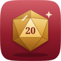</p>

<h1 align="center">Pocket Quest</h1>

<p align="center">Run your tabletop role-playing games, fifth edition: character sheets built step by step by the rules (and levelled up by them), campaigns with game nights, recaps, people, places, lore and a quest log, encounters with the official difficulty budget, an initiative and hit-point tracker for the fight, fair dice — and the whole System Reference Document built in. Your players get a page with what they may see, never a secret.<br>One Go binary, one SQLite file, one volume. Part of the Pocket apps; works on its own too.</p>

<p align="center">
  <a href="https://github.com/abjelosevic88/pocket-homelab-quest/actions/workflows/ci.yml"></a>
  <a href="https://github.com/abjelosevic88/pocket-homelab-quest/pkgs/container/pocket-homelab-quest"></a>
  <a href="LICENSE"></a>
</p>

<p align="center">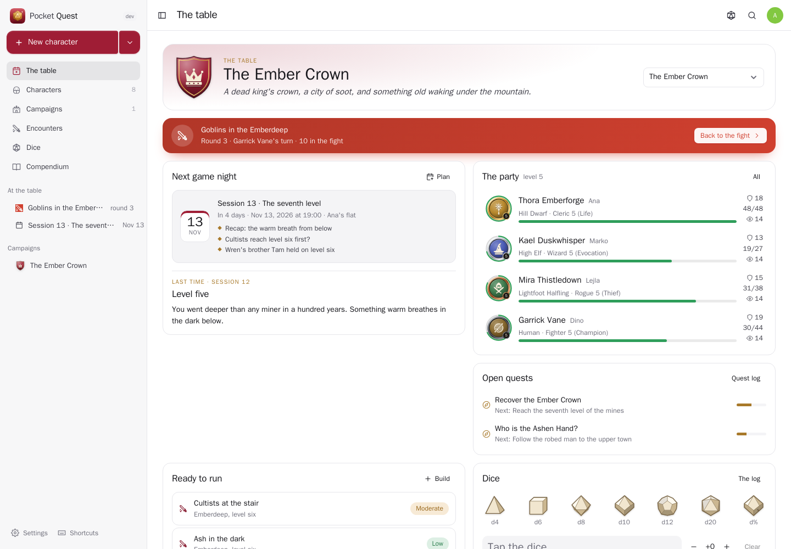</p>

<table>
  <tr>
    <td width="50%">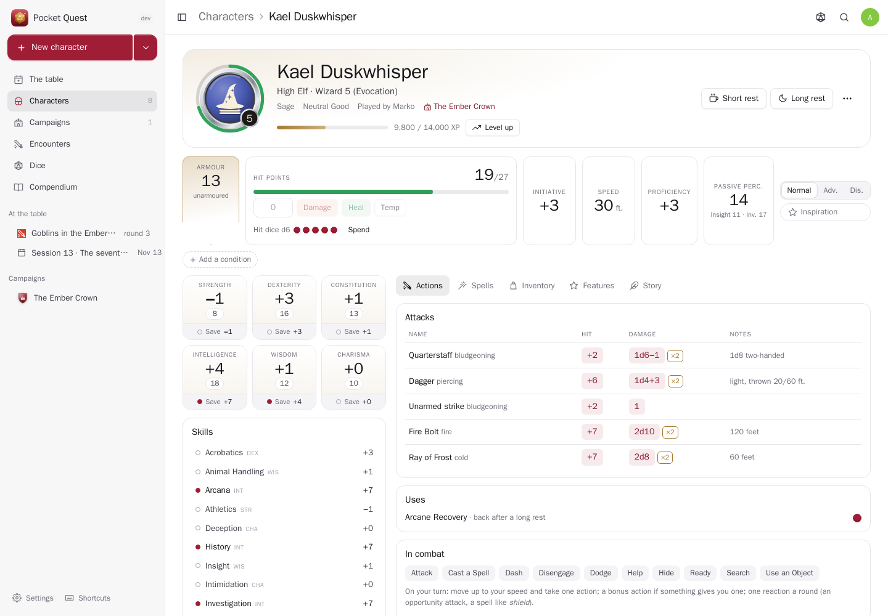</td>
    <td width="50%">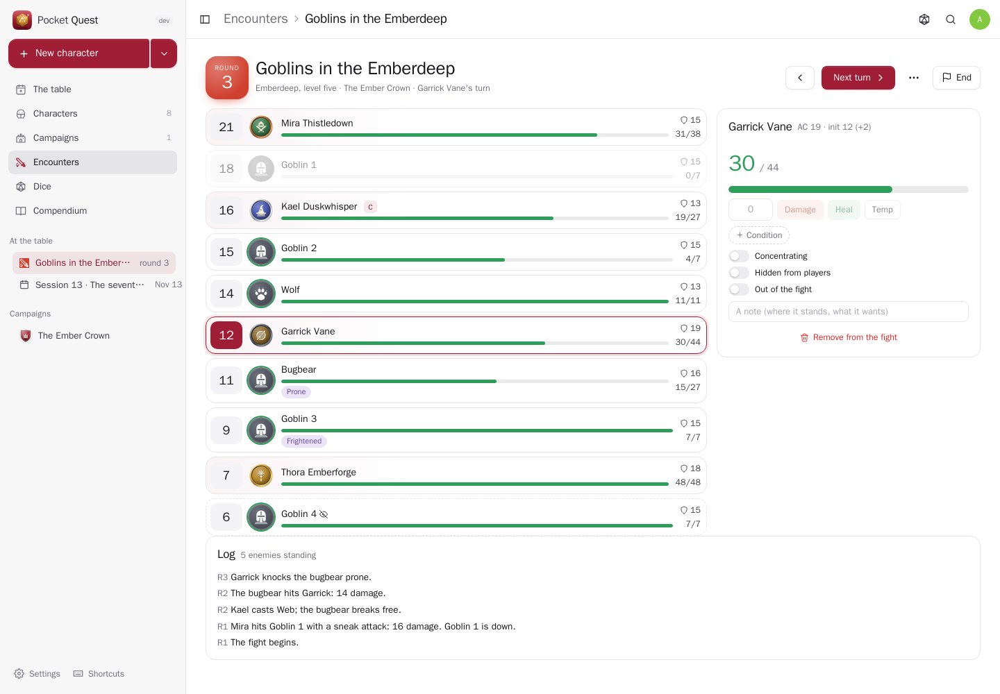</td>
  </tr>
  <tr>
    <td align="center"><sub>A character sheet: every number worked out by the rules, every number a roll.</sub></td>
    <td align="center"><sub>The fight: initiative order, whose turn, hit points, conditions, concentration — the party's hit points go back to their sheets.</sub></td>
  </tr>
  <tr>
    <td width="50%">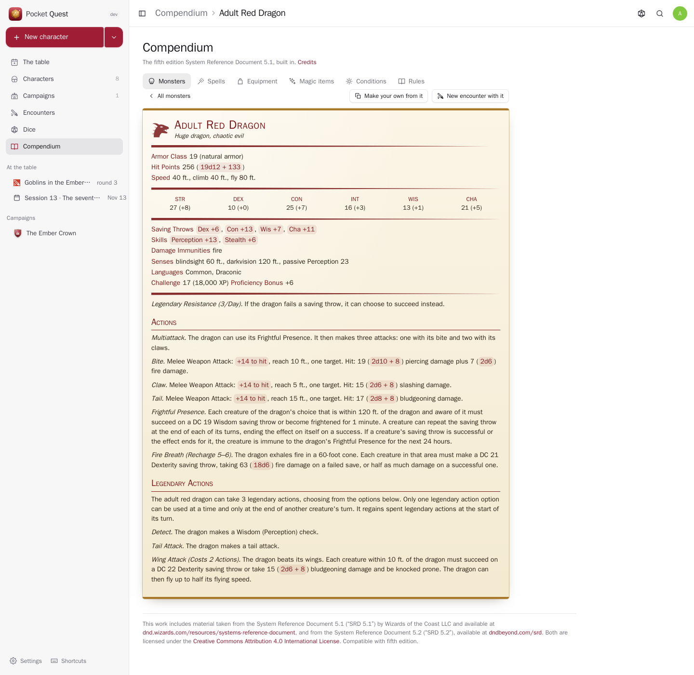</td>
    <td width="50%">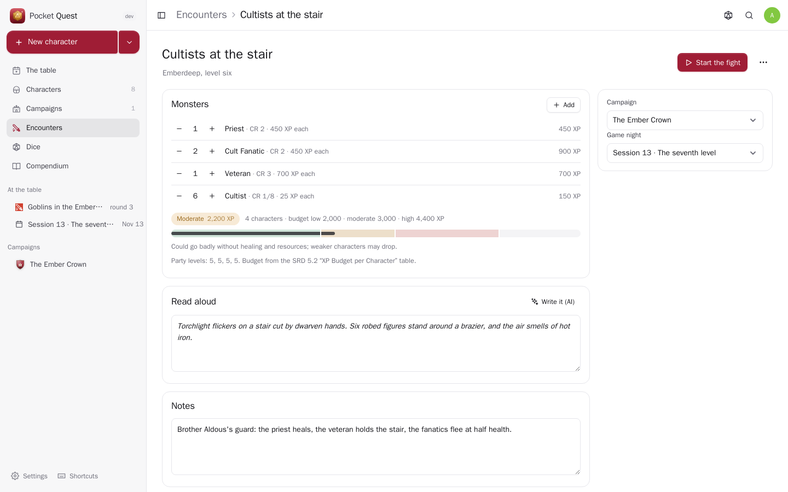</td>
  </tr>
  <tr>
    <td align="center"><sub>334 monsters as classic stat blocks; attack and damage numbers roll. Make your own from any of them.</sub></td>
    <td align="center"><sub>An encounter rated for your party with the SRD 5.2 XP budget (low, moderate, high), with read-aloud text.</sub></td>
  </tr>
  <tr>
    <td width="50%">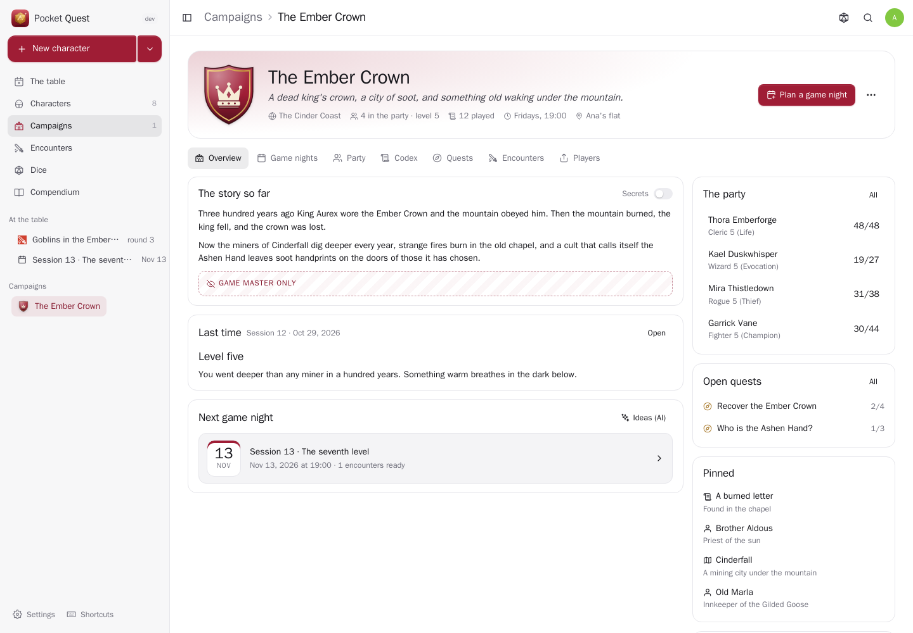</td>
    <td width="50%">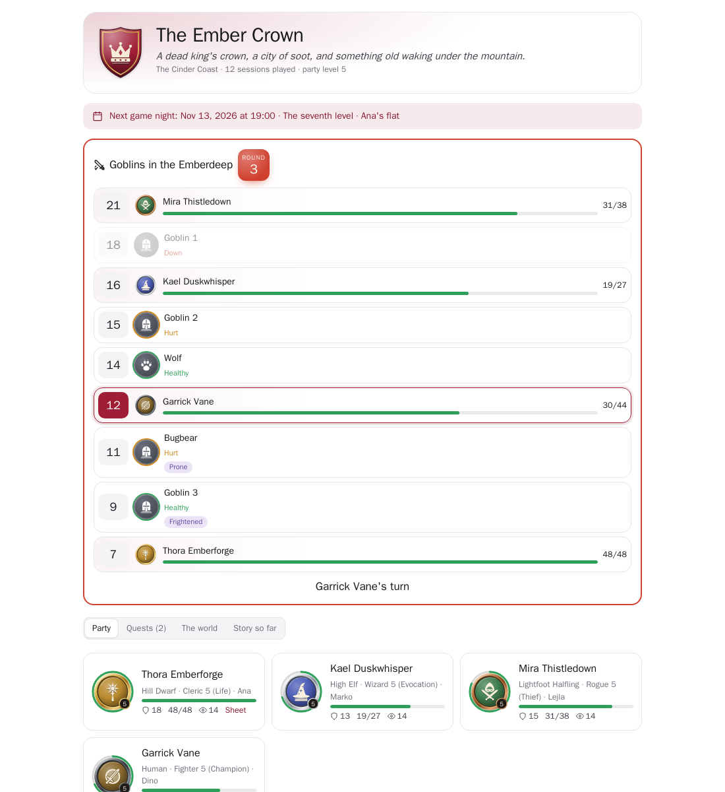</td>
  </tr>
  <tr>
    <td align="center"><sub>A campaign: what the players know and your secrets, the last game night, the party, quests, pinned people and places.</sub></td>
    <td align="center"><sub>The players' page, live: the fight (monsters' health in words), the party, quests, what you revealed, the recaps.</sub></td>
  </tr>
  <tr>
    <td width="50%">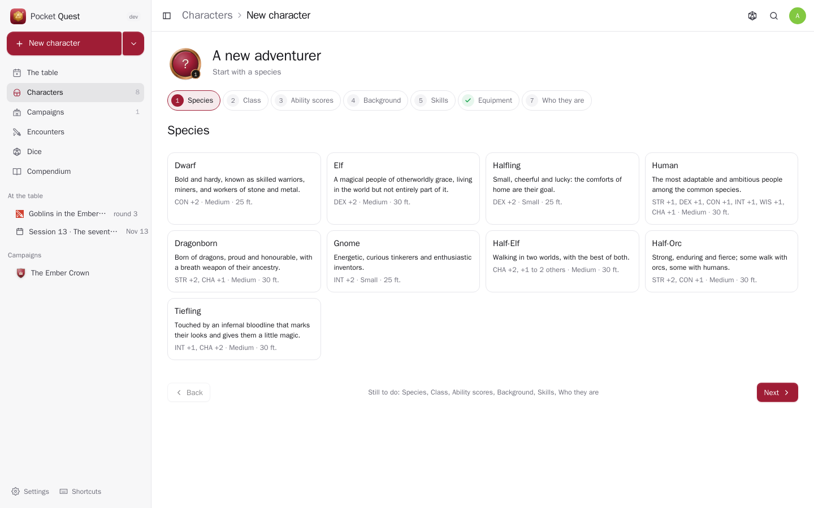</td>
    <td width="50%">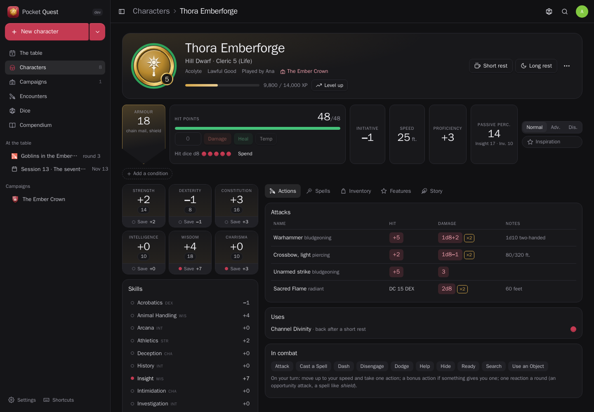</td>
  </tr>
  <tr>
    <td align="center"><sub>The builder: species, class, ability scores (standard array, point buy, 4d6), background, skills, equipment, spells.</sub></td>
    <td align="center"><sub>Light and dark follow your device.</sub></td>
  </tr>
</table>

<p align="center">
  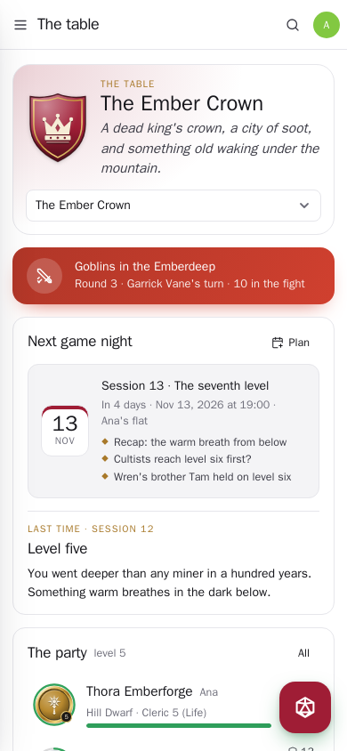
  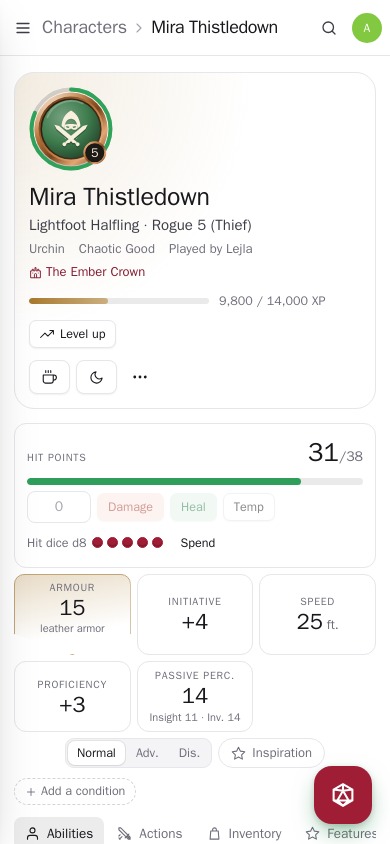
  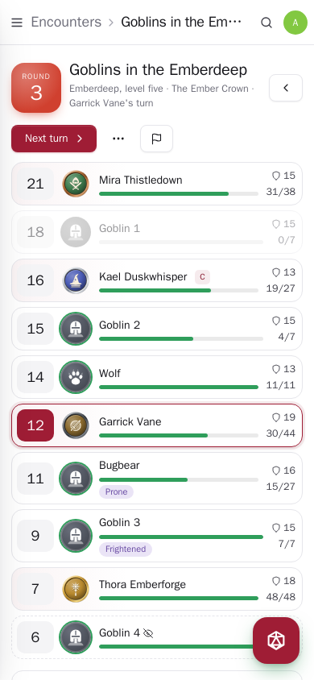
  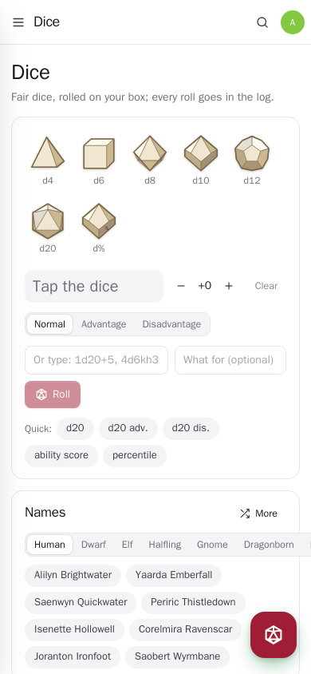
</p>

## What it does

- **Characters by the rules (SRD 5.1).** Nine species with their subspecies, twelve classes with their SRD subclasses, the Acolyte or your own background. Ability scores by standard array, point buy (27 points) or 4d6 drop the lowest, species bonuses on top. Skills, languages, the class's equipment choices, cantrips and first spells. The sheet works everything out: modifiers, saves, skills (expertise, Jack of All Trades, Remarkable Athlete), armour class from what is worn (Unarmored Defense, Draconic Resilience, the Defense style, magic +1s), hit points per level (Dwarven Toughness included), speed and encumbrance, weapon attacks (finesse, Martial Arts, Dueling, Archery, critical range for Champions), cantrip damage by level, Sneak Attack dice, spell save DC and attack, spells prepared and known, spell slots — with the multiclassing table — and Pact Magic. Rests restore what they should; hit dice, death saves, conditions, exhaustion and inspiration are a tap.
- **Levelling up.** Experience from game nights and fights (the SRD's thresholds) or by milestones; take the average hit points or roll, choose the subclass at its level, an ability score improvement or a feat, see the new features; multiclassing checks the 13s.
- **Campaigns.** What the players know and what only you know, house rules, when and where you play. **Game nights** with your prep, notes during the game, the recap (the AI can write it from your notes), treasure and XP for those who were there. **The codex**: people, places, factions, items, lore and handouts — each with what may be revealed and what stays secret, a picture, and for a person a stat block. **The quest log** with steps.
- **Encounters.** Pick monsters (or your own), see the fight rated for your party with the SRD 5.2 budget, write the read-aloud text, then run it: initiative rolled, the party added, next turn with the space bar, damage and healing with temporary hit points, conditions with their rules in a tooltip, concentration checks in the log, death saves, legendary actions, hidden monsters. End it and the beaten monsters' XP is shared out.
- **Dice.** Fair dice rolled on your box: tap dice into a pool, advantage and disadvantage, any expression (`4d6kh3`, `2d20kl1`, `1d20+5`), critical damage. Every number on a sheet or stat block rolls; everything goes into the log. Names for people, taverns and places when you need one.
- **The compendium**: 334 monsters, 319 spells, equipment, 341 magic items, the conditions and the rules text, searchable.
- **The players' page** (`/p/…`, off until you switch it on; a new link stops the old one) and **shared sheets** (`/c/…`), read only, on any phone.
- **Everyone their own** on one box. **Messages** through Apprise, ntfy or a webhook: the day before a game night, and when a character can level up.

## Run it

```sh
docker run -d --name pocket-quest -p 8080:8080 -v ./data:/data \
  -e BASE_URL=https://quest.example.com -e SECURE_COOKIES=true \
  ghcr.io/abjelosevic88/pocket-homelab-quest:latest
```

or `docker compose up -d` with [docker-compose.yml](docker-compose.yml). Open it, create the first account and build a character. All options: [docs/configuration.md](docs/configuration.md). API: [docs/api.md](docs/api.md). Backups: [docs/backup.md](docs/backup.md).

## With Pocket Core

Set `CORE_URL` and `CORE_REGISTRATION_KEY` and Quest joins the box: people sign in with Pocket Core, Pocket AI helps, and through app links your games reach your own Pocket apps with nothing to paste:

| App | In Quest | Without it | Scopes |
|---|---|---|---|
| Pocket Calendar | game nights on your calendar, moved and removed with the plan; what else is on when you pick a date | — | `calendar:read`, `calendar:write` |
| Pocket Notes | a game night or a backstory as a note | export | `notes:write` |
| Pocket Chat | the next game night, a recap, a handout, a quest or a character in the party's chat | the players' page | `chat:read`, `chat:write` |
| Pocket Tasks | the lines of your prep as tasks, due the day before | — | `tasks:write` |

**Nothing depends on another app.** Each app's state is checked per person, and what needs it is shown greyed out with one line saying why, never hidden.

Other apps use your games through `quest:read` and `quest:write`: Pocket AI tells you about the next game night, plans one, rolls dice or changes a character's hit points when you ask; Pocket Day can show game nights in your journal (`GET /day/{date}`); Pocket Search finds characters, campaigns and monsters. They never see your secrets. Events on the bus — `quest.session_planned`, `quest.session_played`, `quest.character_created`, `quest.character_leveled`, `quest.encounter_finished`, `quest.quest_completed` — start flows in Pocket Flows. The AI (recaps, people and places, backstories, read-aloud text, ideas for the next game night, rules questions) can also be your own OpenAI-compatible key.

## Develop

```sh
make dev     # API on :8080 with demo data + Vite on :5173
make test    # go vet, go test, tsc
make         # web + binary
```

`sh scripts/screenshots.sh` takes the screenshots above from a demo instance. The rules content is compacted from the SRD by `scripts/srd/convert.py` (see [internal/srd/ATTRIBUTION.md](internal/srd/ATTRIBUTION.md)). MIT licensed.

## Rules content

This work includes material taken from the System Reference Document 5.1 (“SRD 5.1”) by Wizards of the Coast LLC and available at https://dnd.wizards.com/resources/systems-reference-document. The SRD 5.1 is licensed under the Creative Commons Attribution 4.0 International License available at https://creativecommons.org/licenses/by/4.0/legalcode.

This work includes material from the System Reference Document 5.2 (“SRD 5.2”) by Wizards of the Coast LLC, available at https://www.dndbeyond.com/srd. The SRD 5.2 is licensed under the Creative Commons Attribution 4.0 International License, available at https://creativecommons.org/licenses/by/4.0/legalcode.

Pocket Quest is compatible with fifth edition (5E compatible). Its artwork — class emblems, crests, dice, tokens, the icon — is its own.
